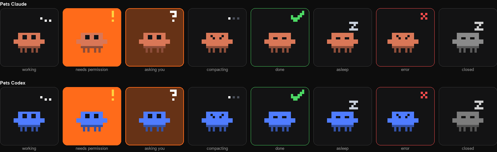

# Pets IA

<p align="center">
  
</p>

Una tira flotante en el borde de la pantalla con una criatura pixel-art animada por cada sesión de **Claude Code** y de **Codex**, en **macOS y Windows**. Cada criatura muestra qué hace su sesión, y las que te esperan no pasan desapercibidas. Haz clic en una y se abre su sesión donde se está ejecutando.

> Basado en [Perch](https://github.com/elrincondeldev/perch) (MIT), que hace esto para Claude Code en Mac. Pets IA añade Windows, Codex y la apertura en VS Code.
>
> **No es un proyecto oficial** de Anthropic ni de OpenAI. "Claude" es marca de Anthropic, PBC; "Codex" y "ChatGPT", de OpenAI.

## Instalación

**macOS** (14 o superior):

```bash
curl -fsSL https://raw.githubusercontent.com/Lucosiar/Pets-IA/main/install.sh | bash
```

**Windows** (10 u 11, x64), en PowerShell:

```powershell
irm https://raw.githubusercontent.com/Lucosiar/Pets-IA/main/install.ps1 | iex
```

El instalador descarga la última versión de [Releases](https://github.com/Lucosiar/Pets-IA/releases) y ejecuta `petsia setup`, que:

- copia los binarios a `~/Library/Application Support/pets-ia/bin` (Mac) o `%LOCALAPPDATA%\PetsIA\bin` (Windows);
- añade hooks a `~/.claude/settings.json` y a `~/.codex/hooks.json` (haciendo antes una copia de seguridad), para que cada herramienta avise al agente de Pets IA;
- arranca el agente y la tira ahora y en cada inicio de sesión (LaunchAgents en Mac; una entrada en *Inicio* del usuario en Windows, sin permisos de administrador).

**Codex pide aprobar los hooks nuevos** la primera vez: en la terminal con `/hooks`, y en la app en *Ajustes → Hooks → Trust*. Si instalas Claude Code o Codex más tarde, vuelve a ejecutar `petsia setup`.

```bash
petsia status             # qué está instalado y en marcha
petsia uninstall          # lo quita todo; pregunta antes de borrar tus fijados
```

(`petsia` está en la carpeta `bin` de arriba.)

## Qué sesiones ve

| Herramienta | Dónde | Se ve | Al hacer clic |
|---|---|---|---|
| Claude Code | App de escritorio (pestaña Code) | Sí | Abre la sesión en la app, aunque esté parada |
| Claude Code | VS Code (extensión) | Sí | Abre la sesión en VS Code (`vscode://anthropic.claude-code/open`) |
| Claude Code | Terminal | Sí | Te avisa de que está en una terminal |
| Codex | App de Codex | Sí | Abre el hilo en la app (`codex://threads/<id>`) |
| Codex | VS Code (extensión) | Sí | Abre la carpeta del proyecto en VS Code |
| Codex | Terminal | Sí | Te avisa de que está en una terminal |
| Chats de claude.ai o ChatGPT | Web, escritorio, móvil | No | No tienen hooks ni nada que se pueda leer desde fuera |

Las sesiones de Claude son naranjas y las de Codex azules por defecto; al pasar el ratón ves de cuál es y dónde corre, p. ej. `mi-app — Codex · VS Code`.

## Uso

- **Las sesiones que elijas**: el **+** del final lista las sesiones recientes de la app de Claude y de Codex; elige una para fijarla. Las no fijadas solo aparecen mientras trabajan o te esperan, y cinco minutos después de terminar.
- **Una criatura por sesión**, animada según su estado: trabajando, necesita permiso, te pregunta, compactando, terminada, error o cerrada. Las terminadas se duermen a los cinco minutos.
- **Difícil de ignorar**: un permiso pendiente hace parpadear la casilla en naranja; una pregunta la rodea de naranja. Al terminar su turno muestra un check verde.
- **Pasa el ratón** para ver nombre, herramienta, dónde corre y estado (`Bash: npm test`, `terminado · 5m`…).
- **Clic** para abrir la sesión. **Clic derecho** para fijarla o quitarla y elegir personaje y color.
- **No molesta**: la tira flota encima de todo sin quitarte el foco. La pestaña con la flecha la recoge contra el borde (y parpadea en naranja si una sesión te necesita).
- **Menú** en la barra de menús (Mac) o en el área de notificación (Windows): mostrar u ocultar la tira, elegir borde izquierdo o derecho, ver cuántas sesiones te esperan y salir.

## Cómo funciona

```
Claude Code ─ hooks ─┐
Codex ─────── hooks ─┼─▶ petsia agent ◀─ WebSocket (127.0.0.1:7788, token) ─ tira (Swift en Mac, WPF en Windows)
claude agents ─ poll ┘    └ SQLite: fijados e iconos
```

- **`petsia`** (`agent/`, Bun y TypeScript compilado a un binario) es el CLI y el agente. Los hooks de ambas herramientas ejecutan `petsia hook claude|codex`, que reenvía el evento al agente y siempre termina sin salida ni error, así que nunca bloquea ni cambia lo que hace la herramienta.
- **Mac**: `petsia-overlay` (`Sources/`, Swift con AppKit y Core Animation), sin icono en el Dock.
- **Windows**: `petsia-overlay.exe` (`windows/PetsIA/`, C# y WPF, autocontenido), sin ventana en la barra de tareas. Mantiene el agente en marcha y lo para al salir.
- **`shared/protocol.ts`** es el contrato entre agente y tiras.

| Qué lee el agente | Para qué | ¿Documentado? |
|---|---|---|
| Hooks de Claude Code (`~/.claude/settings.json`) | Cambios de estado al instante | Sí |
| Hooks de Codex (`~/.codex/hooks.json`) | Cambios de estado al instante | Sí |
| `claude agents --json` | Nombres, procesos vivos, correcciones | Sí |
| `vscode://anthropic.claude-code/open?session=` y `codex://threads/` | Abrir sesiones | Sí |
| `claude://code/continue?session=local_…` | Abrir sesiones de la app de Claude | No |
| `claude-code-sessions/` de la app de Claude | Sus sesiones y sus ids `local_…` | No |
| `~/.codex/sessions/…/rollout-*.jsonl` | Dónde corre cada sesión de Codex y la lista del + | No |

Si una actualización rompe una fuente no documentada, solo deja de funcionar lo que depende de ella.

## Desarrollo

Necesitas [Bun](https://bun.sh) 1.3+; para la tira de Mac, las Command Line Tools de Xcode; para la de Windows, el SDK de .NET 8.

```bash
(cd agent && bun install && bun test)   # agente
swift run PetsCoreTests                 # lógica de la tira de Mac
bun scripts/build.ts                    # compila la release del sistema en el que estás, en dist/
```

Cada push compila y prueba ambas versiones en GitHub Actions. Al subir una etiqueta `v*` (p. ej. `git tag v0.1.0 && git push --tags`) se publica una release con los binarios de Mac (Apple Silicon e Intel) y Windows, que es lo que descargan los instaladores.

## Privacidad

- Todo se queda en tu equipo: el agente solo escucha en 127.0.0.1 y no hay telemetría.
- El WebSocket exige el token de `config.json` en la carpeta de datos y solo acepta `open`, `pin`, `icon` y `library`, con argumentos validados.
- La etiqueta al pasar el ratón puede mostrar detalles de herramientas, como un comando de shell.

## Licencia

[MIT](LICENSE)
